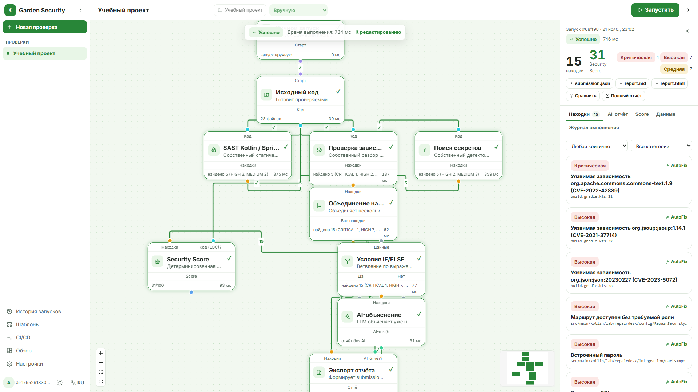

# AI Security Workflow

Визуальная платформа автоматизации проверок безопасности кода для команд на **Kotlin / Spring / Gradle**
(Cyber Garden 2026, кейс «Центр-инвест»).

Сценарий проверки собирается из блоков в редакторе:

**триггер → источник кода → сканеры SECRET / SCA / SAST → логика → AI-объяснение → уведомления, экспорт, CI gate**

Движок исполнения и анализаторы написаны с нуля: n8n, Node-RED, Semgrep, Gitleaks, Trivy и подобные не используются.
LLM ничего не обнаруживает. Она объясняет готовые находки, и её ответ проходит валидатор (файлы, строки, CVE,
версии). Без LLM платформа работает в детерминированном режиме.

| Что умеет | Где подробнее |
| --- | --- |
| Редактор графа: drag & drop, типизированные порты, проверка до запуска, живая подсветка нод и потоков данных | [docs/NODES.md](docs/NODES.md) |
| Собственные анализаторы: учебный набор 15/15 без ложных срабатываний, три мутанта без пропусков | [docs/ANALYZERS.md](docs/ANALYZERS.md) |
| AI-отчёт с индикатором доверия, AI-генерация сценария из текста, чат-правки графа | [docs/AI.md](docs/AI.md) |
| Запуск вручную, по расписанию, по вебхуку, из CI (exit 1 на Critical), статусы и комментарии в PR/MR | [docs/CI_CD.md](docs/CI_CD.md) |
| Библиотека шаблонов: публикация с очисткой секретов, поиск, рейтинг, отзывы | — |
| Diff-aware проверки, Security Score с трендом, AI AutoFix с самопроверкой и PR | [docs/TEAM_FEATURES.md](docs/TEAM_FEATURES.md) |
| Шифрование секретов, маскирование везде, allowlist, SSRF-защита, роли, аудит | [docs/SECURITY.md](docs/SECURITY.md) |



## Быстрый старт (5 команд)

Нужны Docker с Compose v2 и свободные порты 8080 и 8000.

```bash
git clone <этот репозиторий> aisw && cd aisw
cp .env.example .env
docker compose --profile mock up -d --build     # postgres, backend, worker, frontend + локальные mock-сервисы
docker compose ps                               # backend и frontend должны стать healthy (≈30 с)
open http://localhost:8080                      # Linux: xdg-open; или просто откройте адрес в браузере
```

Зарегистрируйтесь: личный workspace создаётся автоматически, первый пользователь в нём — admin.

- **Порты.** Если 8080 занят, задайте в `.env` `FRONTEND_PORT=8088`, `APP_PUBLIC_URL=http://localhost:8088`,
  `APP_CORS_ORIGINS=http://localhost:8088`.
- **Проверка без браузера** (нужен Python 3.12 с `httpx`, например venv backend):

  ```bash
  python scripts/demo_stack.py --url http://localhost:8080
  ```

  Регистрирует пользователя, создаёт проект и сценарий, запускает его и проверяет: 15 находок, `submission.json`,
  вебхук доставлен на mock, Security Score посчитан.
- **Без профиля `mock`:** `docker compose up -d --build`.
- **Ключи.** В `APP_ENV=dev` ключи шифрования и JWT генерируются один раз в томе `aisw-data`. Для продакшна задайте
  `APP_ENV=prod`, `APP_MASTER_KEY` и `APP_JWT_SECRET` (команда генерации — в `.env.example`).

| Сервис | Адрес |
| --- | --- |
| UI | http://localhost:8080 |
| API и Swagger | http://localhost:8000/docs (через UI — `/api/...`) |
| Mock Telegram / Webhook / SMTP (профиль `mock`) | http://localhost:8025/_received, SMTP `localhost:2525` |
| Mock GitHub / GitLab REST (профиль `mock`) | http://localhost:8026/_requests |

Остановка: `docker compose --profile mock down`. Полная очистка данных: `make clean` (`down -v`).

## Настройка LLM

По умолчанию платформа использует **NVIDIA Nemotron** (`nvidia/nemotron-3.5-lightning-30b-a3b`).
Укажите `NVIDIA_API_KEY` в корневом `.env` для Compose или в `backend/.env` для локального запуска.

Чтобы обрабатывать данные локально, администратор может выбрать **Ollama** в «Настройки → AI»,
указать адрес сервера и установленную модель, сохранить выбор и проверить соединение.
Для всей установки тот же выбор задаёт `LLM_PROVIDER=ollama`.

```bash
docker compose --profile ollama up -d
docker compose exec ollama ollama pull qwen2.5:3b
```

Внутри Compose адрес сервиса — `http://ollama:11434`. Если backend и Ollama запущены на хосте,
используйте `http://localhost:11434`.

Без LLM AI-отчёт формируется детерминированно (шаблонные объяснения по правилам), лог ноды прямо об этом сообщает.
SCA AutoFix работает без LLM.

## Настройка уведомлений

Секреты (токен бота, пароль SMTP, HMAC-ключ вебхука) задаются в **Настройки → Секреты**, в нодах выбираются ссылкой.
Значения не возвращаются API и маскируются в логах.

| Канал | Нода | Реальный сервис | Демо на mock (профиль `mock`) |
| --- | --- | --- | --- |
| Telegram | `notify.telegram` | токен от @BotFather, `chat_id` | `APP_TELEGRAM_API_BASE=http://mock:8025` в `.env` и перезапуск: любой токен, сообщения видны на `:8025/_received` |
| E-mail | `notify.smtp` | host, порт, STARTTLS/SSL, логин и пароль | host `mock`, порт `2525`, без TLS |
| HTTP Webhook | `notify.webhook` | любой https URL; заголовок `X-AISW-Signature` (HMAC-SHA256) | URL `http://mock:8025/<любой путь>` |

Текст сообщений — шаблон с подстановками `{{findings.count}}`, `{{severity.critical}}`, `{{verdict}}`, `{{score.value}}`, `{{run.url}}`
и другими. Полный список — в [docs/NODES.md](docs/NODES.md#шаблоны-сообщений).

Исходящие запросы проходят SSRF-фильтр: локальные и внутренние адреса доступны только из `APP_SSRF_ALLOW_HOSTS`.

## Демо-сценарий

Интерфейс — одно рабочее пространство: слева список проверок, в центре граф, справа настройки выбранной ноды или
итоги запуска. История, шаблоны, CI/CD, обзор и настройки открываются панелями поверх графа.

1. **Новая проверка** (открывается сама при первом входе или кнопкой «+ Новая проверка»):
   - **что проверяем:**
     - ссылка на любой публичный репозиторий (https; ссылка на папку `…/tree/<ветка>/<путь>` тоже подходит) с
       галочкой «это учебный или собственный проект» — подтверждение пишется в аудит;
     - или архив проекта;
     - или «Учебный проект» организаторов;
   - **с чего начать:** «Полная проверка», «Только секреты», «Проверка PR (diff)», пустой граф или «Описать словами
     (AI)»;
   - **«Создать и запустить»** — три действия от входа до живого запуска.
2. **Граф и запуск.** Работающая нода переливается неоновой рамкой, по рёбрам бегут «пакеты» данных со счётчиками,
   по завершении по успешным нодам проходит волна свечения. Результаты сразу справа:
   - находки (новые и существующие);
   - AI-отчёт с индикатором доверия;
   - Security Score;
   - данные между нодами и журнал;
   - выгрузки `submission.json`, Markdown и HTML.
3. **Конструктор.**
   - Палитра: кнопка «Ноды», клавиша `Tab` или «+» под выбранной нодой — новая нода встаёт ниже и подключается сама.
     Перетаскивание на холст тоже работает.
   - Связи тянутся между портами. Недопустимая связь отклоняется с причиной.
   - Настройки ноды — в правой панели. Отмена и повтор, раскладка, импорт и экспорт JSON. Сохраняется автоматически.
   - Источник кода и запуск (вручную, по расписанию ЧЧ:ММ, вебхук) переключаются в шапке.
4. **AI AutoFix.** Находка в итогах → «Проверить патч» → чеклист и diff → `.patch` или PR (для репозиториев с
   `allow_write`) → «Применить патч и перепроверить» (новый запуск на копии проекта с патчем).
5. **Шаблоны** (панель): опубликовать текущую проверку, найти, оценить, «Использовать для своего репозитория».
6. **CI/CD** (панель): YAML для GitHub Actions / GitLab CI, API-токен, журнал вебхуков.
7. **AI** («Настройки → AI»). Выберите Nemotron или Ollama и проверьте соединение. Параметры окружения и проверка ответов описаны в [docs/AI.md](docs/AI.md).
8. **Diff-aware и PR от AutoFix** со скриптовым mock GitHub: `make demo-diff`, `make demo-autofix` (запускаются на
   dev-стеке, см. [docs/CI_CD.md](docs/CI_CD.md#демо-без-интернета)).

Сценарий для выступления — [docs/PRESENTATION_NOTES.md](docs/PRESENTATION_NOTES.md#13-сценарий-живой-демонстрации-10-минут).

## Разработка и тесты

Нужны Python 3.12 + [uv](https://docs.astral.sh/uv/) и Node.js 20+.

```bash
make install            # backend/.venv (uv) + frontend/node_modules
make dev-backend        # alembic upgrade head + uvicorn :8000 со встроенным воркером (SQLite в backend/data)
make dev-frontend       # vite :5173, /api проксируется на :8000
```

| Команда | Что проверяет |
| --- | --- |
| `make test` | backend pytest (578 тестов) + frontend vitest (23) |
| `make test-eval` | точность анализаторов: учебный набор организаторов и мутанты (`pytest -m eval`) |
| `make test-pg` | интеграционные тесты на PostgreSQL в Docker (порт 55432) |
| `make e2e` | Playwright: регистрация → сценарий → запуск → результаты. На macOS: `PW_CHANNEL=chrome` |
| `make lint` | ruff (backend, scripts) + `tsc --noEmit` |
| `make smoke` | сквозная проверка поднятого Compose-стека |
| `make demo-full` | демо-сценарий §21 (шаги 1–8, 10) на Compose-стеке; с LLM — `make demo-full MODEL=qwen2.5:3b` |
| `make docs` | перегенерация `docs/NODES.md` и `docs/API.md` из кода |

## Структура проекта

```text
backend/
  app/analyzers/   собственные анализаторы: secrets, sca, sast (tree-sitter-kotlin), diff; модель Finding
  app/engine/      граф, валидатор, исполнитель (asyncio), события/SSE, очередь, воркер, планировщик, выражения
  app/nodes/       ноды-плагины: одна нода = один файл
  app/ai/          LLM-провайдеры, промпты, валидатор ответа, детерминированный fallback, генерация сценариев
  app/scoring/     Security Score, тренд, Priority Fix List, AI-план
  app/autofix/     AutoFix: контекст, валидатор, SCA-bump, PR/MR
  app/ci/          статусы и комментарии в PR/MR, генератор YAML
  app/core/        шифрование, маскирование, SSRF, repo_guard, JWT/argon2, аудит
  app/api/         REST /api
  alembic/         миграции
  tests/           unit, engine, nodes, api, ci, security, eval, integration
frontend/src/      React 18 + TS + Vite + Tailwind + @xyflow/react + Zustand + TanStack Query + i18next (RU/EN)
cli/aisw_ci.py     CLI для пайплайнов (только stdlib)
scripts/           mock-сервисы, демо-скрипты, генераторы документации
fixtures/          учебный набор организаторов и мутанты (только чтение), собственные фикстуры
docker/            entrypoint и nginx
docs/              ARCHITECTURE, NODES, ANALYZERS, API, CI_CD, AI, SECURITY, TEAM_FEATURES, PRESENTATION_NOTES, REPORT
```

## Как добавить новую ноду

Один файл в `backend/app/nodes/<группа>/`. Движок, API, редактор и документацию менять не нужно. Нода появится в
`GET /api/nodes`, в палитре редактора (форма строится из JSON Schema) и после `make nodes-doc` — в `docs/NODES.md`.

```python
# backend/app/nodes/logic/path_exclude.py
import fnmatch

from app.engine.data import findings_envelope, findings_of
from app.nodes.base import BaseNode, Port, register_node
from app.nodes.schema import obj, prop


@register_node
class PathExcludeNode(BaseNode):
    type = "logic.path_exclude"
    category = "logic"
    icon = "filter"
    title = {"ru": "Исключить пути", "en": "Exclude paths"}
    description = {"ru": "Убирает находки в файлах по glob-маскам.", "en": "Drops findings by glob masks."}
    inputs = [Port("in", "findings", title_ru="Находки", title_en="Findings")]
    outputs = [Port("out", "findings", title_ru="Находки", title_en="Findings")]
    config_schema = obj({"globs": prop("array", "Маски", "Globs", items={"type": "string"}, default=["*/test/*"])})

    async def execute(self, ctx, inputs, config):
        kept = [f for f in findings_of(inputs["in"])
                if not any(fnmatch.fnmatch(f.path, g) for g in config.get("globs", []))]
        ctx.log("info", f"оставлено {len(kept)} находок")
        return {"out": findings_envelope(kept, ctx.node_id)}
```

- **Секреты** нода получает через `ctx.secret(credential_id)`: значение сразу регистрируется в маскировщике.
- **HTTP-запросы** — через `app.core.ssrf.safe_request`.
- **Новый LLM-провайдер** — класс с `@register_provider` в `backend/app/ai/providers/`.

## Подключение CI

1. **Настройки → Интеграция:** выберите сценарий (с нодой `output.ci_gate`), выпустите API-токен, скопируйте YAML
   для GitHub Actions или GitLab CI.
2. В CI-переменные добавьте `AISW_URL` и `AISW_TOKEN`.
3. Job скачивает `aisw_ci.py` с платформы, отправляет код, ждёт вердикт и завершается кодом `1` при Critical
   (diff-aware: блокируют только новые находки).
4. Включите защиту ветки (required status check / «Pipelines must succeed»).

Альтернатива — вебхук GitHub/GitLab на `/api/v1/webhooks/{github|gitlab}` с HMAC-подписью: статус коммита и
комментарий в PR/MR возвращаются автоматически, для этого нужен `allow_write` в allowlist. Подробно —
[docs/CI_CD.md](docs/CI_CD.md).

## Ограничения и честные оговорки

- **Живая проверка Nemotron** охватывает одну синтетическую находку. В разделе 8 [отчёта](docs/REPORT.md) приведены результат и метрики валидации.
- **Реальные Telegram, SMTP, GitHub и GitLab** не проверялись. Интеграции проверены на локальных mock-серверах
  (`scripts/mock_services.py`, `scripts/mock_scm.py`), которые повторяют их HTTP-API.
- **Анализаторы покрывают Kotlin/Spring/Gradle.** Java, Groovy-скрипты (кроме Gradle Groovy DSL для зависимостей) и
  другие языки не анализируются SAST. SCA использует локальный справочник `backend/vulndb/` — онлайн-баз нет.
- **Справочник уязвимостей** — учебный набор организаторов, расширяется JSON-файлом по схеме.
- **Rate limit входа** хранится в памяти процесса API.
- **Восстановление исходников для PR AutoFix** из `git_url` не покрыто сквозным тестом: проверены сценарии вебхука и
  каталога.
- **Скрипты `demo_diff` и `demo_autofix`** рассчитаны на dev-стек (локальный uvicorn), а не на Compose.

Полный журнал работ, гейтов и проверок — [docs/REPORT.md](docs/REPORT.md).
