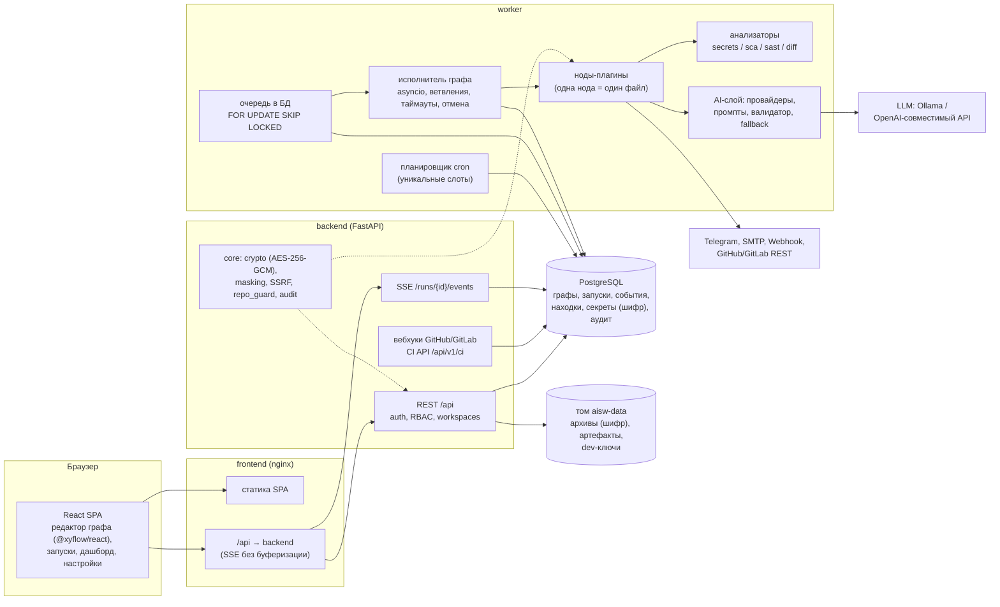
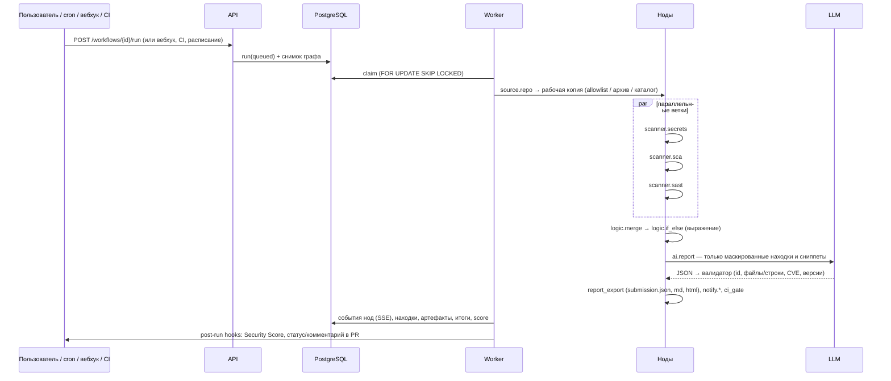

# Архитектура

AI Security Workflow — визуальная платформа автоматизации проверок безопасности кода. Сценарий — это граф нод:
триггер → источник кода → собственные анализаторы (SECRET / SCA / SAST для Kotlin/Spring/Gradle) → логика → AI-объяснение
→ уведомления, экспорт, CI gate. Движок исполнения и анализаторы написаны с нуля. Готовые workflow-платформы и чужие
сканеры не используются. LLM ничего не обнаруживает: она объясняет уже найденные проблемы и предлагает исправления,
и её ответ всегда проходит валидатор.

## Компоненты

Сервисы Compose: `postgres`, `backend` (API, при старте выполняет `alembic upgrade head`), `worker` (планировщик и
исполнитель, можно запустить несколько экземпляров), `frontend` (nginx). Профили: `mock` — локальные Telegram, SMTP,
Webhook, GitHub и GitLab для демо без интернета; `ollama` — локальная LLM.

## Поток данных запуска

1. **Создание запуска.** API сохраняет снимок графа (`runs.graph_snapshot`): последующая правка сценария не меняет
   идущий запуск.
2. **Очередь.** Воркер забирает запуск через `SELECT … FOR UPDATE SKIP LOCKED`. Heartbeat позволяет перезапустить
   упавший запуск один раз, после чего он завершается ошибкой.
3. **Исполнитель** (`engine/executor.py`) идёт по топологическому порядку и запускает независимые ветки параллельно.
   - Нода стартует, когда все предшественники завершены.
   - Ребро активно, если источник успешен и выдал данные на этом порту.
   - Невыбранная ветка IF/ELSE пропускается (`skipped`) вместе со всем, что зависит только от неё.
   - У каждой ноды есть таймаут; запуск можно отменить.
4. **Данные между нодами** передаются конвертами `Envelope(type, data, meta)`. Порты типизированы: `findings`,
   `repo`, `report`, `json`, `text`, `any`, `trigger`. Несовместимые соединения отклоняет валидатор графа и до
   сохранения, и перед запуском.
5. **События** (`run_events`) сохраняются в БД и отдаются по SSE: подсветка нод в редакторе, логи и «поток данных» по
   рёбрам работают и после перезагрузки страницы.
6. **Post-run hooks** (`engine/runs.py::POST_RUN_HOOKS`): расчёт Security Score и отправка статуса/комментария в
   GitHub/GitLab (только для репозиториев с `allow_write`).

## Ноды (плагины)

Нода — это один класс в одном файле под `backend/app/nodes/**` с декоратором `@register_node`. Пакет обнаруживается
автоматически. Порты и JSON Schema параметров описаны в классе: API (`GET /api/nodes`), редактор (форма строится из
JSON Schema) и документация (`make nodes-doc` → [NODES.md](NODES.md)) подхватывают ноду без правок в других местах.
Пример новой ноды — в [README](../README.md#как-добавить-новую-ноду).

Группы: триггеры (manual, schedule, webhook — также для CI) · источник кода · сканеры (secrets, sca, sast, diff) · логика
(if_else, merge, severity_filter, regex, compare, set_value) · анализ (security_score) · AI (report, autofix)
· вывод (telegram, smtp, webhook, report_export, ci_gate).

## Модули backend

| Пакет | Назначение |
| --- | --- |
| `app/analyzers/` | Собственные анализаторы: `secrets`, `sca` (Gradle DSL, lockfile, catalog, CVSS), `sast` (tree-sitter-kotlin, taint, граф вызовов, Spring Security), `diff` (hunks, blame, классификация new/existing), общая модель `Finding`. |
| `app/engine/` | Граф, валидатор, исполнитель, события и SSE, очередь, воркер, планировщик, безопасные выражения и шаблоны. |
| `app/nodes/` | Ноды-плагины. |
| `app/ai/` | Провайдеры (`openai_compat`, `ollama`; новый провайдер — класс с `@register_provider`), промпты, схемы, валидатор достоверности, детерминированный fallback, генерация сценариев. См. [AI.md](AI.md). |
| `app/scoring/` | Security Score, тренд, Priority Fix List, AI-план спринта. |
| `app/autofix/` | Контекст, валидатор, SCA-bump, восстановление исходников, PR/MR. |
| `app/ci/` | Статусы и комментарии в PR/MR, генератор YAML. См. [CI_CD.md](CI_CD.md). |
| `app/core/` | Криптография, маскирование, SSRF, repo_guard, JWT/argon2, аудит, ошибки. См. [SECURITY.md](SECURITY.md). |
| `app/api/` | REST, единый формат ошибок. См. [API.md](API.md). |

## Хранение

PostgreSQL (в тестах и при локальной разработке — SQLite), миграции Alembic.

| Таблицы | Содержимое |
| --- | --- |
| `users`, `workspaces`, `memberships`, `invitations`, `refresh_tokens`, `audit_log` | пользователи, роли, приглашения, сессии, аудит |
| `credentials` | шифртекст AES-256-GCM с версией ключа |
| `projects`, `uploads` | источники кода; архивы на диске зашифрованы, TTL |
| `workflows`, `schedules`, `schedule_slots` | графы и расписания |
| `runs`, `node_runs`, `run_events`, `findings`, `artifacts` | история запусков |
| `ai_settings`, `ai_reports`, `workflow_chat_messages` | настройки провайдера; отчёты LLM и AI-планы с журналом валидатора; чат-правки графа |
| `autofixes` | исправления и шаги валидации |
| `templates`, `template_ratings`, `template_reviews`, `template_favorites` | библиотека шаблонов |
| `api_tokens`, `webhook_deliveries`, `ci_status_reports` | CI/CD |
| `repo_allowlist` | разрешённые репозитории и флаг `allow_write` |

## Расширение за минуту

- **Новая нода:** один файл в `app/nodes/<группа>/` (пример в README) и `make nodes-doc`.
- **Внешний сервис** (например, Slack): нода-уведомление в `app/nodes/output/`. Исходящий запрос — через
  `core/ssrf.safe_request`, секреты — через `ctx.secret(credential_id)` (значение сразу регистрируется для маскирования).
- **Переключение на локальную LLM:** Настройки → AI-провайдер → `ollama`, `http://ollama:11434` (профиль `ollama`)
  или любой OpenAI-совместимый URL. Код менять не нужно.
- **Новый LLM-провайдер:** класс-наследник `LLMProvider` с `@register_provider` в `app/ai/providers/`.
